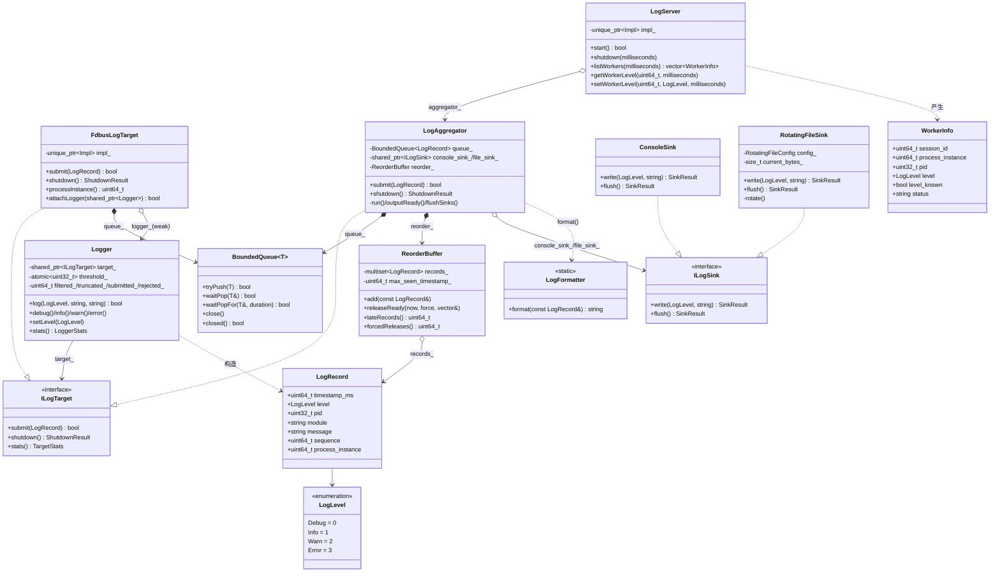

# IPC 日志系统 · 设计文档（核心类图）

## 核心类图

## 图码对应

| 类 | 头文件 | 关键函数（代码锚点） |
|---|---|---|
| Logger | include/ipc_log/logger.h | `Logger::log` / `setLevel` |
| ILogTarget | include/ipc_log/log_target.h | `submit` / `shutdown` / `stats` |
| FdbusLogTarget | include/ipc_log/fdbus_transport.h | `submit` / `shutdown` / `attachLogger` |
| LogAggregator | include/ipc_log/log_aggregator.h | `submit` / `shutdown` / `run` |
| BoundedQueue | include/ipc_log/async_queue.h | `tryPush` / `waitPop` |
| ReorderBuffer | include/ipc_log/reorder_buffer.h | `add` / `releaseReady` |
| ILogSink | include/ipc_log/sink.h | `write` / `flush` |
| ConsoleSink | include/ipc_log/sink.h · src/console_sink.cpp | `write` |
| RotatingFileSink | include/ipc_log/sink.h · src/rotating_file_sink.cpp | `write` / `rotate` |
| LogServer | include/ipc_log/fdbus_transport.h | `start` / `listWorkers` / `setWorkerLevel` |
| LogFormatter | include/ipc_log/log_formatter.h | `format` |
| LogRecord / LogLevel | include/ipc_log/log_record.h | — |

> 注：答辩 HTML 内联的 SVG 版为清晰度省略了两条次要关系——`FdbusLogTarget → Logger`（`weak_ptr` 弱引用，用于控制回调改等级）、`ReorderBuffer → LogRecord`（内部 `std::multiset` 存储）；本页 Mermaid 版为完整版。
