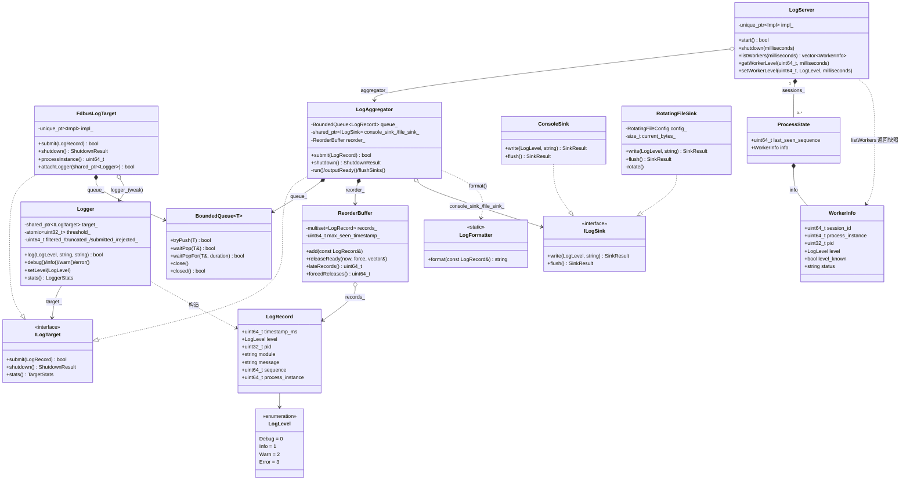

# IPC 日志系统详细设计

## 核心类图

## 图码对应

| 类 | 头文件 | 关键函数（代码锚点） |
|---|---|---|
| Logger | include/ipc_log/logger.h | `Logger::log` / `setLevel` |
| ILogTarget | include/ipc_log/log_target.h | `submit` / `shutdown` / `stats` |
| FdbusLogTarget | include/ipc_log/fdbus_transport.h | `submit` / `shutdown` / `attachLogger` |
| LogAggregator | include/ipc_log/log_aggregator.h | `submit` / `shutdown` / `run` |
| BoundedQueue | include/ipc_log/async_queue.h | `tryPush` / `waitPop` |
| ReorderBuffer | include/ipc_log/reorder_buffer.h | `add` / `releaseReady` |
| ILogSink | include/ipc_log/sink.h | `write` / `flush` |
| ConsoleSink | include/ipc_log/sink.h · src/sinks/console_sink.cpp | `write` |
| RotatingFileSink | include/ipc_log/sink.h · src/sinks/rotating_file_sink.cpp | `write` / `rotate` |
| LogServer | include/ipc_log/fdbus_transport.h | `start` / `listWorkers` / `setWorkerLevel` |
| LogFormatter | include/ipc_log/log_formatter.h | `format` |
| LogRecord / LogLevel | include/ipc_log/log_record.h | — |

> 图中队列嵌套框表示成员归属；A/B 为会话条目示意。蓝线表示记录与消息传递，灰线表示类关系。外部通过 LogAggregator::submit 提交，由其内部调用 queue_.tryPush。

## 日志数据与关键时序

正常路径中的业务调用只负责过滤、构造记录和本地入队。发送线程完成 Protobuf 编码；服务回调解码并校验，汇聚线程在记录释放时格式化并调用两个 Sink。

代码锚点：src/common/logger.cpp · Logger::log；src/client/fdbus_transport.cpp · Impl::run；src/server/log_server.cpp · Impl::handleRecord；src/server/log_aggregator.cpp · outputReady。人工核对：ACK 确认服务端汇聚队列接收，输出线程独立推进。

~~~mermaid
sequenceDiagram
    participant B as 业务线程/Logger
    participant Q as 客户端FIFO
    participant T as 发送线程/FDBus
    participant S as LogServer接收回调
    participant A as 汇聚FIFO/重排
    participant O as 控制台与文件
    B->>Q: 过滤后的LogRecord
    Q-->>B: 本地入队结果
    Q->>T: 出队
    T->>S: Protobuf LogRecord
    S->>A: 校验后入队
    S-->>T: LogReply
    A->>A: 有限窗口重排
    A->>O: 统一格式化文本
~~~

### 断连与恢复

离线时，发送线程可能已取出一条记录并等待连接，其余记录受客户端 FIFO 容量约束。尚未提交的记录在上线后继续发送；已提交但结果未知的请求不自动重发，计入 uncertain。

代码锚点：src/client/fdbus_transport.cpp · waitUntilOnline / sendRequest / run；Client::onOnline / onOffline。人工核对：区分“尚未提交”与“提交后未知”，不能对两者使用同一重试策略。

~~~mermaid
sequenceDiagram
    participant B as 业务线程
    participant Q as 客户端FIFO
    participant T as 发送线程
    participant S as 日志服务
    B->>Q: 新LogRecord
    Q->>T: 取出记录
    Note over T: 离线，持有当前未提交记录等待
    S-->>T: onOnline
    T->>S: Protobuf记录
    S-->>T: LogReply
~~~

### 退出排空

业务端先关闭本地目标，日志服务再停止接入并关闭汇聚器。业务 shutdown 不发送远程 flush；服务端消费剩余队列、释放排序缓存并刷新两个输出流。

代码锚点：examples/fdbus-console-demo/demo_client.cpp · main；src/client/fdbus_transport.cpp · shutdown；apps/log_server_main.cpp · main；src/server/log_aggregator.cpp · run / flushSinks。人工核对：两端各自收尾，业务端完成不替代服务端输出完成。

~~~mermaid
sequenceDiagram
    participant B as 业务进程
    participant T as 客户端发送线程
    participant Q as 服务端汇聚FIFO
    participant R as 重排缓存
    participant O as 两个Sink
    B->>T: 本地队列剩余记录
    T->>Q: FDBus上报
    Q-->>T: 接收确认
    Note over B,T: 客户端收尾后退出
    Note over Q,O: 日志服务停止接入并关闭汇聚器
    Q->>R: 取出积压记录
    R->>O: 剩余记录格式化并写出
    O->>O: flush两个输出流
~~~

## 接口与线程约定

| 接口 | 结果含义 | 执行位置 |
|---|---|---|
| Logger::log(level, module, text) → bool | true 表示目标接受记录；false 可能是过滤或拒收 | 业务线程 |
| ILogTarget::submit(record) → bool | 本目标的有界队列是否接收 | 调用线程；不等待输出 I/O |
| ILogTarget::shutdown() → ShutdownResult | 本目标的收尾与累计统计 | 生命周期管理线程 |
| LogServer::getWorkerLevel / setWorkerLevel → WorkerControlResult | 核对实例、请求及实际等级后 confirmed；超时可能 uncertain | 主线程发起并等待；context 回调完成结果 |
| ILogSink::write / flush → SinkResult | 单次输出或刷新是否成功 | 汇聚消费线程 |

完整签名见 include/ipc_log/logger.h、log_target.h、fdbus_transport.h、sink.h。控制请求直接进入客户端控制回调，修改 Logger 原子阈值，不占用日志 FIFO。阈值属于绑定的 Logger；示例每进程一个 Logger/目标。

## 排序、格式化与统计

- 排序键为时间戳及稳定辅助字段；释放条件包括时间水位、输入空闲、容量超限和退出收尾。
- late_records 记录晚于已释放水位的迟到记录；forced_releases 只记录非 drain 时因容量超限提前释放，不包含退出或空闲 drain。
- 协议时间为 epoch 毫秒；输出前转为本地可读时间。文本形如：[2026-10-30 09:15:02.123][INFO][PID:12345][orders][order created]。
- 客户端区分 dropped、rejected、uncertain；服务端累计写错误。流刷新不等于 fsync。

## 日志调用流程

代码锚点：src/common/logger.cpp · log；include/ipc_log/async_queue.h · tryPush。人工核对：过滤与拒收是不同结果，队列容量不会因满载自动扩张。

~~~mermaid
flowchart LR
    A[日志调用] --> B{等级达到阈值}
    B -- 否 --> F[filtered计数]
    B -- 是 --> C[构造LogRecord]
    C --> D{目标有界入队}
    D -- 成功 --> E[后台发送]
    D -- 拒收 --> G[拒收计数并返回]
~~~

## 方案评审入口

- 异步队列隔离业务 I/O 等待；其代价是线程、容量及关闭顺序的管理。
- client/server 便于接收确认与实例定向控制；pub/sub 更适合多订阅者广播。
- Protobuf 提供字段和编解码约束；直接 socket 需要自行补齐发现、分帧、会话及重连。
- 共享内存适合大批量交换，但需自行处理同步、容量和崩溃恢复。
- 本机文件部署简单；远程收集增加网络时延与失败点，还需要缓冲、去重、安全和收集端运维。远程收集为方案分析。
