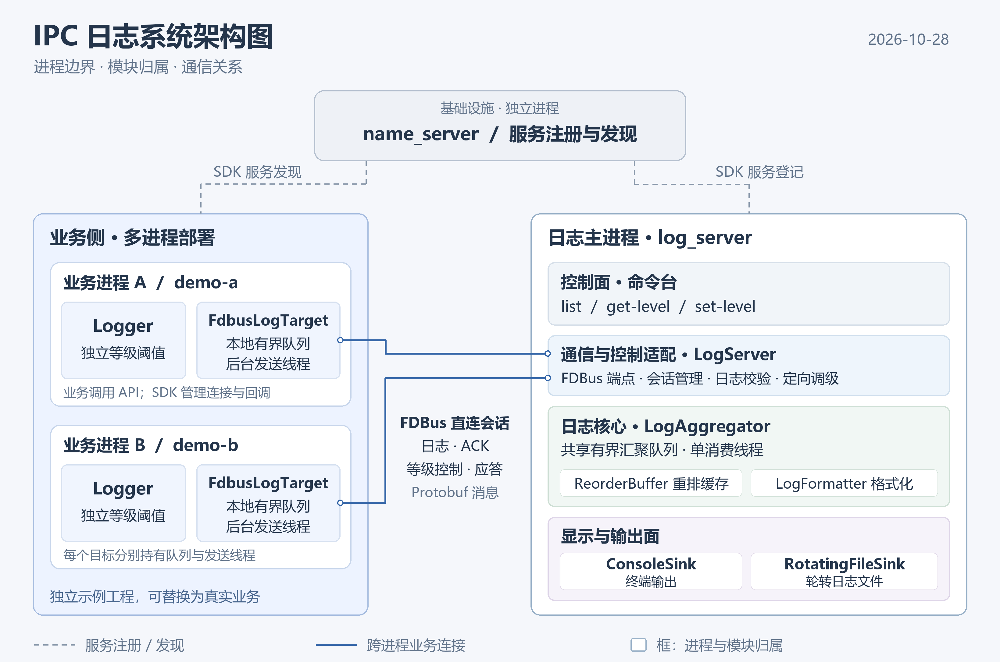
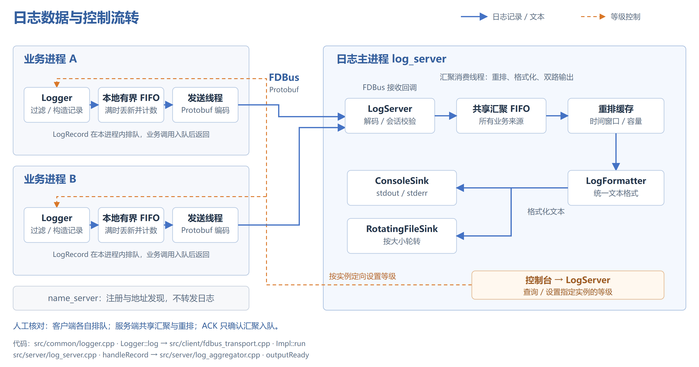

# IPC 日志系统整体架构

## 一、设计目标

面向 Linux 多进程业务，通过 FDBus 汇聚日志，支持四级过滤、实例独立动态调级、毫秒时间戳，以及控制台和轮转文件输出。业务日志调用不等待网络应答和输出 I/O。

技术基础：C++11、FDBus、Protobuf、CMake。

## 二、系统结构

| 运行角色 | 核心职责 |
|---|---|
| 业务进程 | 过滤和构造记录、本地排队、后台上报；接收定向等级控制 |
| 日志主进程 log_server | 接收与校验、共享汇聚、排序和双路输出；提供等级控制入口 |
| FDBus name_server | 服务注册与地址发现，帮助业务进程和日志服务建立直接会话 |

## 三、模块划分

| 模块 | 职责与依赖 |
|---|---|
| Logger / ILogTarget | Logger 维护等级阈值并构造记录，通过目标接口提交，不依赖具体传输和输出 |
| FdbusLogTarget / LogServer | 负责客户端上报、服务端接收及定向控制，封装 FDBus 与 Protobuf |
| LogAggregator / ReorderBuffer | 管理共享有界队列和重排缓存，由唯一消费线程推进输出 |
| LogFormatter / ILogSink | 记录释放后统一格式化，写入控制台和轮转文件 |

## 四、数据与控制流转

客户端各自持有队列；服务端所有来源共用汇聚队列和重排缓存。等级控制按实例更新对应 Logger 的阈值，已入队记录继续处理。

## 五、执行与收尾

- **业务调用与发送分离：**业务线程完成过滤、构造和有界入队；每个客户端目标有一个发送线程，负责序列化、上报和等待应答。
- **通信回调与输出分离：**FDBus context 处理连接和消息回调；唯一汇聚线程负责排序、格式化和两个 Sink 的写入。
- **两端分别收尾：**先停止业务输入并关闭客户端目标，再停止服务接入；日志主进程排空汇聚队列、释放重排剩余记录并刷新两个 Sink。

## 六、关键设计选择

| 选择 | 理由与影响 |
|---|---|
| 源头过滤、集中定向调级 | 减少无效记录构造和 IPC，各业务实例仍能独立控制等级 |
| 有界异步队列、满时丢新并计数 | 保护业务响应和内存，过载损失可观察 |
| 单条请求应答、未知结果不自动重发 | 简化请求关联，避免重复；吞吐受往返时延影响 |
| 有限窗口排序 | 在等待时间、缓存容量和乱序整理之间取舍，迟到记录继续输出 |
| 共享汇聚、单线程双路输出 | 资源管理简单；突发来源竞争容量，慢 Sink 影响整体消费速度 |

类关系、接口约定和关键时序见 [详细设计](docs/design.md)。数据流转图的可编辑源文件为 [SVG](docs/diagrams/log-data-flow.svg)。
